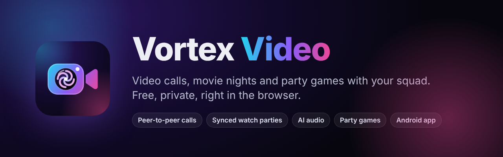
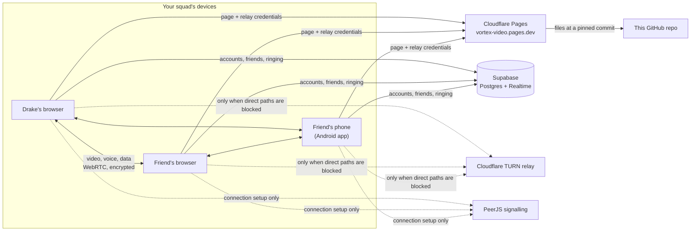

<p align="center">
  
</p>

<p align="center">
  <a href="https://vortex-video.pages.dev"><b>Open Vortex Video</b></a> ·
  <a href="https://vortex-video.pages.dev/download/android"><b>Download for Android</b></a> ·
  <a href="#how-it-works">How it works</a> ·
  <a href="#run-your-own">Run your own</a>
</p>

---

**Vortex Video is a hangout app for small friend groups: a video call, a movie theater and a game night in one browser tab.** Calls go directly between your devices, movies play in sync on everyone's screen at full quality, and there's nothing to install. On Android, an app is available that opens it full screen.

It's built for the way friends actually hang out online: someone starts a call, someone else puts on a movie, the movie dips when people talk, and between episodes you play a round of trivia. It's one tab, with no account needed for your guests and no time limit.

## Why Vortex

Most tools do one of these jobs well and make you stitch the rest together. A call app and a watch-party extension mean two windows, two invite links and a movie that never quite lines up with anyone's voice. Vortex was designed around the whole evening:

- **The movie plays on everyone's own device, in sync.** Nobody is screen-sharing a blurry re-encoded copy. Each person streams the original file, and Vortex keeps playback within a fraction of a second across the squad. Pause, seek or skip from any device and it happens for everyone.
- **Your voices sit on top of the movie.** When a friend talks, the movie automatically dips, then comes back up. Vortex tells a voice apart from the movie leaking out of someone's speakers, so it won't duck all night. Friends' voices go through a clarity and levelling chain, so the mumbler and the shouter end up at the same volume.
- **Calls are peer-to-peer.** Audio and video go straight between your devices, encrypted by WebRTC. They never pass through a Vortex media server. When a strict network blocks direct connections, an encrypted Cloudflare relay takes over automatically.
- **Invite-only by design.** There are no guessable room codes. Only signed-in members can start a call, and guests get in only with a member's invite link. Fake or expired links are refused by the host's device.
- **Free, with no time limit and no install.** Open a link in Chrome, Edge, Firefox or Safari. Guests don't need an account.

### How it compares

| | **Vortex Video** | Discord | Zoom (free) | Google Meet (free) | FaceTime + SharePlay | Teleparty |
|---|---|---|---|---|---|---|
| Video call + watch party in one place | ✅ | ⚠️ Mostly screen share | ⚠️ Screen share | ⚠️ Screen share | ✅ Apple devices | ⚠️ Mostly text chat |
| Each person streams the original video, in sync | ✅ | ⚠️ YouTube activity only | ❌ | ❌ | ✅ Supported apps | ✅ |
| Movie automatically dips when friends talk | ✅ | ❌ | ❌ | ❌ | ✅ | ❌ |
| Works on Android, Windows, Mac and iPhone | ✅ Browser | ✅ App | ✅ App | ✅ | ❌ SharePlay is Apple-only | ⚠️ Desktop browsers |
| Guests join without an account | ✅ | ❌ | ✅ | ⚠️ Depends on settings | ⚠️ Web link, no SharePlay | ⚠️ Extension + own streaming subscription |
| No time limit on group calls | ✅ | ✅ | ❌ 40 min | ❌ 60 min (3+ people) | ✅ | n/a |
| Party games built into the call | ✅ 4 games | ✅ Activities | ❌ | ❌ | ⚠️ Some apps | ❌ |
| Group calls go peer-to-peer (no media server) | ✅ | ❌ | ❌ | ❌ | ❌ | n/a |
| Nothing to install | ✅ | ⚠️ Browser version | ⚠️ Browser version | ✅ | ❌ | ❌ Extension |

<sub>The competitor columns are a summary of their free/standard plans as of October 2026. Plans change, so check their sites before relying on a specific limit.</sub>

### Where others still win

We'd rather you hear this from us:

- **Big groups.** Vortex is a peer-to-peer mesh built for **up to 8 people**. Zoom, Meet and Discord route media through servers and scale to far larger calls.
- **iPhone in the background.** Safari pauses web pages you switch away from. A native app like FaceTime keeps the call alive; a web app can't.
- **Screen sharing from phones.** Android browsers can't share the screen at all, and iPhone support only arrived in iOS 27. Vortex shares screens from computers.
- **Torrents.** Browsers can only download from WebRTC peers and web seeds, so many torrents shared only by desktop clients won't start. Debrid and direct links are the reliable option.

## Features

<table>
<tr><td valign="top" width="50%">

### 🎥 Calls
- Peer-to-peer video calls for up to 8 people, with automatic host migration. The call survives when whoever started it leaves.
- Invite links (24 hours) and **ring a friend** with one tap: accept, audio-only or decline.
- Friends list with online and in-call status.
- Join preview: choose camera and mic before you go in.
- Grid and speaker layouts, pin anyone, raise hand, reactions and chat.
- **Squad PiP**: your friends' faces in a floating window while you use other apps.
- Screen sharing from computers.
- Live captions, call recording and auto clips. Auto clips save the last 20 seconds when the squad laughs or cheers, are opt-in, and show everyone a badge.
- Squad radar: an optional, opt-in map of where friends are, exact or approximate. It's never stored.

</td><td valign="top" width="50%">

### 🍿 Watch together
- **Movies & shows** with Stremio add-ons: sign in to import your add-ons, browse catalogs, pick episodes.
- Streams are ranked by **what actually plays in a browser**: AAC audio and H.264 go to the top, while Dolby, DTS and HEVC are flagged before you click.
- **Browse YouTube** inside the app, or paste any YouTube, video-file, magnet or `.torrent` link.
- Follow a friend's browsing live, and ask whoever has add-ons to start a title.
- **Cinema mode**: full-screen theater with your squad's faces underneath. You can resize, reshape, drag or pop out any face.
- Synced subtitles from torrents and subtitle add-ons, with timing adjustment for everyone.
- Sound modes: Standard, Cinema, Dialogue and Night.
- **Continue watching**: resume any movie for everyone where you left off.

</td></tr>
<tr><td valign="top">

### 🎙️ Studio audio
- **AI noise removal** (RNNoise) strips out fans, keyboards, traffic and TV hum.
- **Auto-tune to your room**: removal strength, noise gate and mic level adapt every couple of seconds.
- Clear, balanced voices: friends' voices are de-boomed, sharpened and levelled, with a soft limiter instead of crackle.
- Automatic movie ducking when friends talk, and a little when you do, so the movie stays out of your mic.
- A connection report that tells network problems apart from a slow computer.

</td><td valign="top">

### ✨ Camera & AI
- WebGL backgrounds, blur, color looks and **12 face filters**, plus skin touch-up.
- **Low-light boost** that lifts shadows without blowing out highlights.
- 60 fps when your camera supports it, with automatic quality adaptation.
- **Hand gestures**: ✋ pause or play for everyone, ☝️ raise your hand, 👍 or 🤟 send a reaction, ✌️ take a squad snapshot.
- Auto-framing that keeps you centered.
- **Live avatar**: a cartoon that copies your expressions, so only the cartoon is sent.

</td></tr>
<tr><td valign="top" colspan="2">

### 🎮 Party games
**Quantum Drop** (1v1) · **Pulse Trivia Blitz** (1–8) · **Cipher Sketch**, a drawing and guessing game (2–8) · **Hyper-Disc Arena** (2–4). Games are played right inside the call, so you can see each other's reactions.

</td></tr>
</table>

## How it works



- **The app** is a single HTML file (`public/index.html`). It has no build step or framework, and its few libraries (PeerJS, WebTorrent, Supabase, MediaPipe, RNNoise, Leaflet) load from public CDNs with pinned versions.
- **Calls** use a full mesh: every member connects directly to every other. The room is a well-known "beacon" peer that admits newcomers and checks their invite. If the beacon holder leaves, the longest-standing member takes over.
- **Accounts, friends and ringing** run on Supabase with row-level security on every table. Rings go through a database function that checks you're friends, rate-limits, and stamps the real sender, so a ring can't be forged. Presence uses one private channel per user, so only your friends see when you're online.
- **Hosting** is a Cloudflare Pages worker that serves `public/` from this repo at a pinned commit, hands out short-lived TURN relay credentials, and publishes the Android app-link file.
- **Android** is a [Trusted Web Activity](https://developer.chrome.com/docs/android/trusted-web-activity): the app opens the site full screen in Chrome, so it gets Chrome's full WebRTC, Picture-in-Picture and codec support. It uses Android's own permission prompts for notifications and location; camera and microphone permissions go through Chrome.

## Repository layout

| Path | What it is |
|---|---|
| `public/` | The website: the app (`index.html`), web manifest, service worker and icons |
| `workers/site/_worker.js` | The Cloudflare Pages worker that serves the site, `/api/turn` and `/.well-known/assetlinks.json` |
| `workers/keepalive/` | A cron Worker that keeps the free Supabase project from pausing |
| `supabase-setup.sql` | Database schema, row-level security and realtime policies (safe to re-run) |
| `android/` | The Android app project (Trusted Web Activity) |
| `releases/` | Signed Android builds |
| `.github/workflows/android.yml` | Builds the Android app on every change to `android/` |

## Run your own

<details>
<summary><b>1. Supabase (accounts, friends, ringing)</b></summary>

1. Create a Supabase project and run `supabase-setup.sql` in the SQL editor.
2. **Realtime → Settings:** turn off "Allow public access" so the private ringing and presence channels are enforced.
3. **Authentication → URL Configuration:** set the Site URL to your site's address.
4. Under **Authentication → Email**, either turn off "Confirm email" or connect your own SMTP provider. Supabase's built-in mailer only delivers to your own team.
5. Put the Project URL and the **publishable** key in `SUPABASE_URL` / `SUPABASE_ANON_KEY` at the top of `public/index.html`. Never use the secret key: the app refuses to run with one.

</details>

<details>
<summary><b>2. Cloudflare (hosting, relay, keep-alive)</b></summary>

1. Create a Pages project and deploy `workers/site/_worker.js` as its `_worker.js`.
2. Set these production variables on the project:
   - `REF`: the commit to serve, as a full SHA. To deploy, point it at a new commit; to roll back, point it at an older one.
   - `TURN_KEY_ID` / `TURN_KEY_TOKEN` (secrets): a Cloudflare Realtime TURN key.
   - `ANDROID_CERT_SHA256`: your Android signing certificate fingerprint.
3. Deploy `workers/keepalive` with `wrangler deploy` from that folder.

</details>

<details>
<summary><b>3. Android app</b></summary>

1. Push a change under `android/`. CI builds an unsigned APK and publishes it to the `android-build` branch along with the matching `apksigner`.
2. Sign it offline with your release key:
   ```sh
   java -jar apksigner.jar sign --ks vortex-release.keystore --out vortex-video.apk app-release-unsigned.apk
   ```
3. Commit the result to `releases/vortex-video.apk`. The site serves it at `/download/android`.

Keep the keystore and its passwords private and backed up. You need the same key for every future update.

</details>

## Privacy & security

- Calls are end-to-end between devices (DTLS-SRTP). When the relay is used, it forwards encrypted packets it can't read.
- No analytics or ads, and no tracking. Movie history, add-ons and API keys stay on your device and are never sent to the squad.
- Your profile (name, username, photo) is visible only to you, your friends and people you have a pending request with.
- Location sharing is opt-in per call, can be rounded to about 1 km, and is never stored.
- The Supabase key in the page is the public *publishable* key. Row-level security protects the data.

## Browser support

Chrome, Edge and Firefox on desktop; Chrome on Android; Safari on iPhone and Mac. Squad PiP, screen sharing and some AI camera features depend on the browser and device, and the app tells you when one isn't available.

---

<p align="center"><sub>Made for movie nights. 🍿</sub></p>
