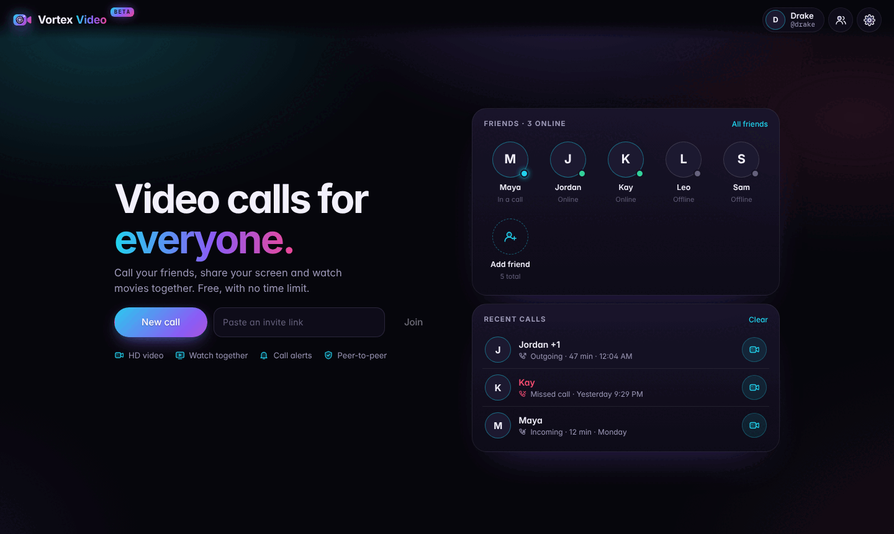
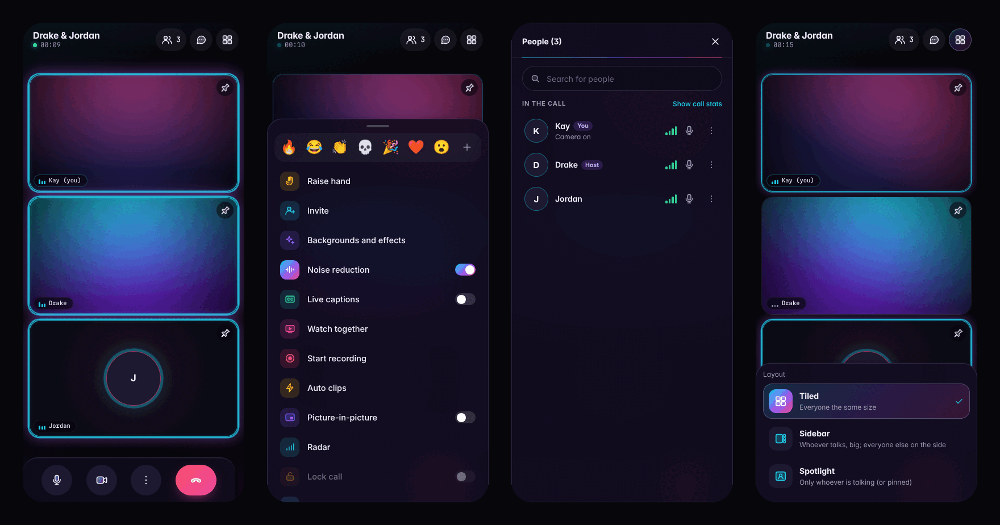

<p align="center">
  
</p>

<p align="center">
  <a href="https://vortex-video.pages.dev"></a>
  <a href="https://github.com/itbelikethatbruh/vortex-video/releases/latest/download/Vortex-Video-Setup.exe"></a>
  <a href="https://vortex-video.pages.dev/download/android"></a>
</p>

<p align="center">
  
  
  
  
</p>

<p align="center">
  <a href="https://vortex-video.pages.dev/welcome.html">Website</a> ·
  <a href="#features">Features</a> ·
  <a href="#how-it-works">How it works</a> ·
  <a href="#downloads">Downloads</a> ·
  <a href="#run-your-own">Run your own</a>
</p>

---

**Vortex Video is a hangout app for small friend groups: a video call and a movie theater in one.** Tap a friend's face to ring them, see who's calling before you answer, and watch movies in sync at full quality. Calls go directly between your devices. It runs in any modern browser, and there are apps for **Windows** and **Android** that ring you even when Vortex is closed.

<p align="center">
  
</p>
<p align="center">
  
</p>

It's built for the way friends actually hang out online: someone starts a call, someone else puts on a movie, and the movie dips when people talk. It's one tab, with no account needed for your guests and no time limit.

## Why Vortex

Most tools do one of these jobs well and make you stitch the rest together. A call app and a watch-party extension mean two windows, two invite links and a movie that never quite lines up with anyone's voice. Vortex was designed around the whole evening:

- **The movie plays on everyone's own device, in sync.** Nobody is screen-sharing a blurry re-encoded copy. Each person streams the original file, and Vortex keeps playback within a fraction of a second for everyone in the call. Pause, seek or skip from any device and it happens for everyone.
- **Your voices sit on top of the movie.** When a friend talks, the movie automatically dips, then comes back up. Vortex tells a voice apart from the movie leaking out of someone's speakers, so it won't duck all night. Friends' voices go through a clarity and levelling chain, so the mumbler and the shouter end up at the same volume.
- **Calls are peer-to-peer.** Audio and video go straight between your devices, encrypted by WebRTC. They never pass through a Vortex media server. When a strict network blocks direct connections, an encrypted Cloudflare relay takes over automatically.
- **Invite-only by design.** There are no guessable room codes. Only signed-in members can start a call, and guests get in only with a member's invite link. Fake or expired links are refused by the host's device.
- **Free, with no time limit and no install.** Open a link in Chrome, Edge, Firefox or Safari. Guests don't need an account.

### How it compares

| | **Vortex Video** | Discord | Zoom (free) | Google Meet (free) | FaceTime + SharePlay | Teleparty |
|---|---|---|---|---|---|---|
| Video call + watch party in one place | ✅ | ⚠️ Mostly screen share | ⚠️ Screen share | ⚠️ Screen share | ✅ Apple devices | ⚠️ Mostly text chat |
| Each person streams the original video, in sync | ✅ | ⚠️ YouTube activity only | ❌ | ❌ | ✅ Supported apps | ✅ |
| Movie automatically dips when friends talk | ✅ | ❌ | ❌ | ❌ | ✅ | ❌ |
| Works on Android, Windows, Mac and iPhone | ✅ Browser, plus Windows and Android apps | ✅ App | ✅ App | ✅ | ❌ SharePlay is Apple-only | ⚠️ Desktop browsers |
| Guests join without an account | ✅ | ❌ | ✅ | ⚠️ Depends on settings | ⚠️ Web link, no SharePlay | ⚠️ Extension + own streaming subscription |
| No time limit on group calls | ✅ | ✅ | ❌ 40 min | ❌ 60 min (3+ people) | ✅ | n/a |
| See the caller's live video before you answer | ✅ | ❌ | ❌ | ❌ | ❌ | n/a |
| Group calls go peer-to-peer (no media server) | ✅ | ❌ | ❌ | ❌ | ❌ | n/a |
| Nothing to install | ✅ | ⚠️ Browser version | ⚠️ Browser version | ✅ | ❌ | ❌ Extension |

<sub>The competitor columns are a summary of their free/standard plans as of October 2026. Plans change, so check their sites before relying on a specific limit.</sub>

### Where others still win

We'd rather you hear this from us:

- **Big groups.** Vortex is a peer-to-peer mesh built for **up to 8 people**. Zoom, Meet and Discord route media through servers and scale to far larger calls.
- **iPhone in the background.** Safari pauses web pages you switch away from. A native app like FaceTime keeps the call alive; a web app can't.
- **Screen sharing from phones.** Chrome on Android gives web apps no way to capture the screen, so Vortex shares screens from computers only. Phones can still watch a share.
- **A full-screen ringing call screen.** Call alerts arrive as a notification with Answer and Decline, not the full-screen incoming-call screen a native app like WhatsApp can show.
- **Torrents.** Browsers can only download from WebRTC peers and web seeds, so many torrents shared only by desktop clients won't start. Debrid and direct links are the reliable option.

## Features

<table>
<tr><td valign="top" width="50%">

### 🎥 Calls
- **A home screen like FaceTime, calls like Meet and Zoom.** Home shows your friends (who's online, who's in a call) and your recent calls, with no camera on. Tap a face to ring someone, tap **New call** to start one, or paste an invite link to get a "Ready to join?" preview.
- **A call screen built for phones**: who you're with and a timer up top, people, chat and layout buttons, and a ⋮ sheet with reactions, raise hand, effects, noise reduction, captions, recording and more.
- **Tiled, Sidebar or Spotlight** layouts, plus pin anyone.
- **People list** with search, connection bars, mic status and per-person options, and optional live call stats.
- **Bad-connection alerts**: when someone starts breaking up, everyone else sees it on their tile, and that person gets a banner with a one-tap fix (turn off camera).
- Peer-to-peer video calls for up to 8 people, with automatic host migration. The call survives when whoever started it leaves.
- Invite links (24 hours) and **ring a friend** with one tap: accept, audio-only or decline.
- **See who's calling, live.** While your phone rings, the caller's camera plays on the ringing card (video only). They can't see or hear you until you answer, and callers can turn it off in Settings.
- **Call alerts** when Vortex is closed or your phone is locked: "Drake is calling" with Answer and Decline, and a missed-call note if you don't pick up.
- Friends list with online and in-call status.
- Join preview: choose camera and mic before you go in.
- Raise hand, reactions and chat bubbles.
- **Picture-in-picture**: your friends' faces in a floating window while you use other apps.
- Screen sharing from computers (desktop only).
- Live captions, call recording and auto clips. Auto clips save the last 20 seconds when everyone laughs or cheers, are opt-in, and show everyone a badge.
- Radar: an optional, opt-in map of where friends are, exact or approximate. It's never stored.

</td><td valign="top" width="50%">

### 🍿 Watch together
- **Movies & shows** with Stremio add-ons: sign in to import your add-ons, browse catalogs, pick episodes.
- Streams are ranked by **what actually plays in a browser**: AAC audio and H.264 go to the top, while Dolby, DTS and HEVC are flagged before you click.
- **Browse YouTube** inside the app, or paste any YouTube, video-file, magnet or `.torrent` link.
- Follow a friend's browsing live, and ask whoever has add-ons to start a title.
- **Cinema mode**: full-screen theater with everyone's faces underneath. You can resize, reshape, drag or pop out any face.
- Synced subtitles from torrents and subtitle add-ons, with timing adjustment for everyone.
- Sound modes: Standard, Cinema, Dialogue and Night.
- **Continue watching**: resume any movie for everyone where you left off.

</td></tr>
<tr><td valign="top">

### 🎙️ Studio audio
- **AI noise removal** (RNNoise) strips out fans, keyboards, traffic and TV hum.
- **Auto-tune to your room**: removal strength, noise gate and mic level adapt every couple of seconds.
- Clear, balanced voices: friends' voices are de-boomed, sharpened and levelled, with a soft limiter instead of crackle.
- Automatic movie ducking when friends talk, and a little when you do, so the movie stays out of your mic.
- A connection report that tells network problems apart from a slow computer.

</td><td valign="top">

### ✨ Camera & AI
- WebGL backgrounds, blur, studio light, color looks and **12 face filters**, plus skin touch-up. Effect previews use your own camera.
- **Low-light boost** that lifts shadows without blowing out highlights.
- 60 fps when your camera supports it, with automatic quality adaptation.
- **Hand gestures**: ✋ pause or play for everyone, ☝️ raise your hand, 👍 or 🤟 send a reaction, ✌️ take a group snapshot.
- Auto-framing that keeps you centered.
- **Live avatar**: a cartoon that copies your expressions, so only the cartoon is sent.

</td></tr>
</table>

## How it works


- **The app** is a single HTML file (`public/index.html`). It has no build step or framework, and its few libraries (PeerJS, WebTorrent, Supabase, MediaPipe, RNNoise, Leaflet) load from public CDNs with pinned versions.
- **Calls** use a full mesh: every member connects directly to every other. The room is a well-known "beacon" peer that admits newcomers and checks their invite. If the beacon holder leaves, the longest-standing member takes over.
- **Accounts, friends and ringing** run on Supabase with row-level security on every table. Rings go through a database function that checks you're friends, rate-limits, and stamps the real sender, so a ring can't be forged. Presence uses one private channel per user, so only your friends see when you're online.
- **Hosting** is a Cloudflare Pages worker that serves `public/` from this repo at a pinned commit, hands out short-lived TURN relay credentials, sends call alerts (Web Push), and publishes the Android app-link file.
- **Windows** is a small [Electron](https://www.electronjs.org/) app (`desktop/`) around the site, with a tray icon so friends can ring you while it's minimized. GitHub Actions builds the installer and publishes it as a release.
- **Android** is a [Trusted Web Activity](https://developer.chrome.com/docs/android/trusted-web-activity): the app opens the site full screen in Chrome, so it gets Chrome's full WebRTC, Picture-in-Picture and codec support. It uses Android's own permission prompts for notifications and location; camera and microphone permissions go through Chrome.

## Repository layout

| Path | What it is |
|---|---|
| `public/` | The website: the app (`index.html`), the landing page (`welcome.html`), web manifest, service worker and icons |
| `desktop/` | The Windows app (Electron) |
| `tools/` | Rebuilds the landing page's Tailwind CSS |
| `workers/site/_worker.js` | The Cloudflare Pages worker that serves the site, `/api/turn` and `/.well-known/assetlinks.json` |
| `workers/keepalive/` | A cron Worker that keeps the free Supabase project from pausing |
| `supabase-setup.sql` | Database schema, row-level security and realtime policies (safe to re-run) |
| `android/` | The Android app project (Trusted Web Activity) |
| `releases/` | Signed Android builds |
| `.github/workflows/android.yml` | Builds the Android app on every change to `android/` |
| `.github/workflows/windows.yml` | Builds the Windows installer and publishes a GitHub release |

## Downloads

| | Get it | Notes |
|---|---|---|
| 🌐 **Web** | [vortex-video.pages.dev](https://vortex-video.pages.dev) | Chrome, Edge, Firefox, Safari. Nothing to install. |
| 🪟 **Windows 10/11** | [Vortex-Video-Setup.exe](https://github.com/itbelikethatbruh/vortex-video/releases/latest/download/Vortex-Video-Setup.exe) | Not code-signed yet: on "Windows protected your PC", click **More info → Run anyway**. SHA-256 and a VirusTotal link are in the [release notes](https://github.com/itbelikethatbruh/vortex-video/releases/latest). |
| 🤖 **Android 7+** | [vortex-video.apk](https://vortex-video.pages.dev/download/android) | Allow "Install unknown apps" for your browser when asked. |

The [download page](https://vortex-video.pages.dev/welcome.html) links each file to its VirusTotal report by SHA-256, so you can check it before installing.

## Run your own

<details>
<summary><b>1. Supabase (accounts, friends, ringing)</b></summary>

1. Create a Supabase project and run `supabase-setup.sql` in the SQL editor.
2. **Realtime → Settings:** turn off "Allow public access" so the private ringing and presence channels are enforced.
3. **Authentication → URL Configuration:** set the Site URL to your site's address.
4. Under **Authentication → Email**, either turn off "Confirm email" or connect your own SMTP provider. Supabase's built-in mailer only delivers to your own team.
5. Put the Project URL and the **publishable** key in `SUPABASE_URL` / `SUPABASE_ANON_KEY` at the top of `public/index.html`. Never use the secret key: the app refuses to run with one.

</details>

<details>
<summary><b>2. Cloudflare (hosting, relay, keep-alive)</b></summary>

1. Create a Pages project and deploy `workers/site/_worker.js` as its `_worker.js`.
2. Set these production variables on the project:
   - `REF`: fallback commit to serve. Deploys write the commit SHA to the `ref` key of the `CONFIG` KV namespace (bound to the project), which takes effect within 30 seconds; to roll back, write an older SHA.
   - `TURN_KEY_ID` / `TURN_KEY_TOKEN` (secrets): a Cloudflare Realtime TURN key.
   - `ANDROID_CERT_SHA256`: your Android signing certificate fingerprint.
   - Call alerts: `VAPID_PUBLIC` (also set as `VAPID_PUBLIC` at the top of `public/index.html`) and `VAPID_PRIVATE_JWK` (secret, the private key as a JWK) — generate a P-256 key pair once. Plus `SUPABASE_URL` and `SUPABASE_ANON_KEY` (the same public values as the app), which `/api/ring` uses to look up a friend's devices with the caller's own sign-in.
3. Deploy `workers/keepalive` with `wrangler deploy` from that folder.

</details>

<details>
<summary><b>3. Windows app</b></summary>

Run the **Windows app** workflow from the Actions tab (or push a `desktop-v*` tag). It builds `Vortex-Video-Setup.exe` on a Windows runner and publishes a release with its SHA-256. Add a `VT_API_KEY` repository secret (a free VirusTotal API key) and each build is also uploaded to VirusTotal.

</details>

<details>
<summary><b>4. Android app</b></summary>

1. Push a change under `android/`. CI builds an unsigned APK and publishes it to the `android-build` branch along with the matching `apksigner`.
2. Sign it offline with your release key:
   ```sh
   java -jar apksigner.jar sign --ks vortex-release.keystore --out vortex-video.apk app-release-unsigned.apk
   ```
3. Commit the result to `releases/vortex-video.apk`. The site serves it at `/download/android`.

Keep the keystore and its passwords private and backed up. You need the same key for every future update.

</details>

## Privacy & security

- Calls are end-to-end between devices (DTLS-SRTP). When the relay is used, it forwards encrypted packets it can't read.
- No analytics or ads, and no tracking. Movie history, add-ons and API keys stay on your device and are never sent to anyone else.
- Your profile (name, username, photo) is visible only to you, your friends and people you have a pending request with.
- Location sharing is opt-in per call, can be rounded to about 1 km, and is never stored.
- The Supabase key in the page is the public *publishable* key. Row-level security protects the data.

## Browser support

Chrome, Edge and Firefox on desktop; Chrome on Android; Safari on iPhone and Mac; the Windows app. Picture-in-picture, screen sharing and some AI camera features depend on the browser and device, and the app tells you when one isn't available.

---

<p align="center"><sub>Made for movie nights. 🍿</sub></p>
